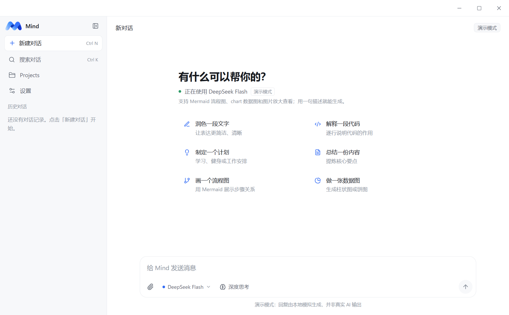
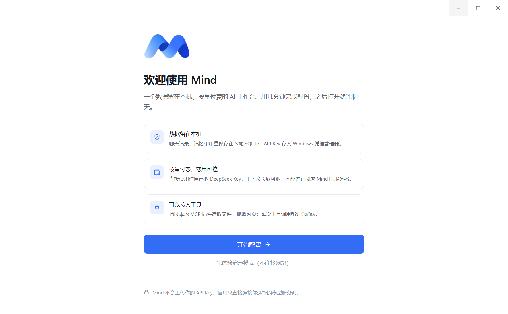
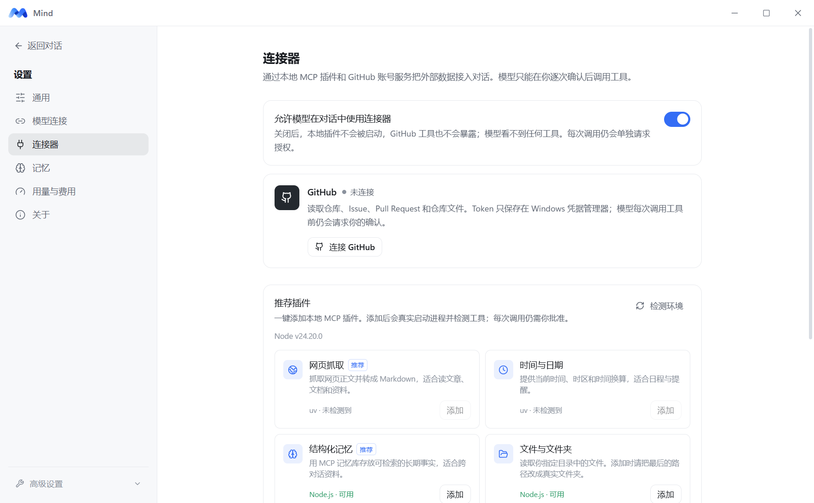
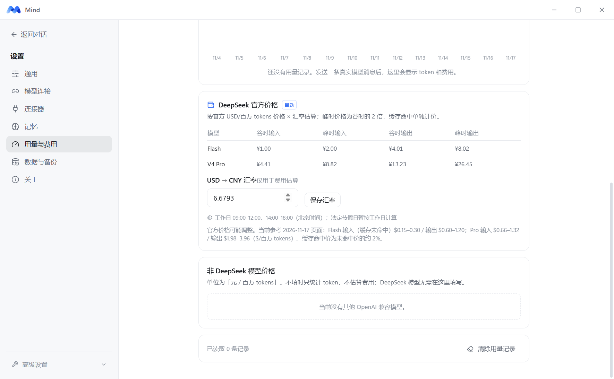
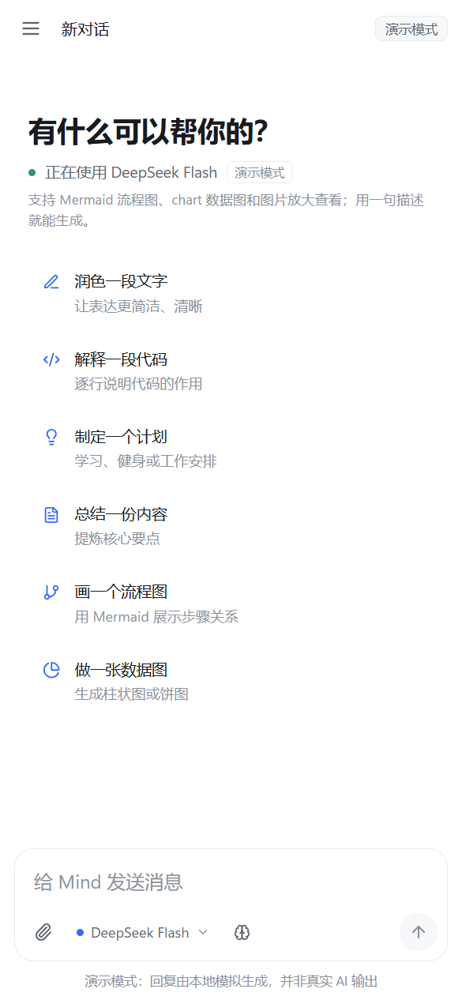
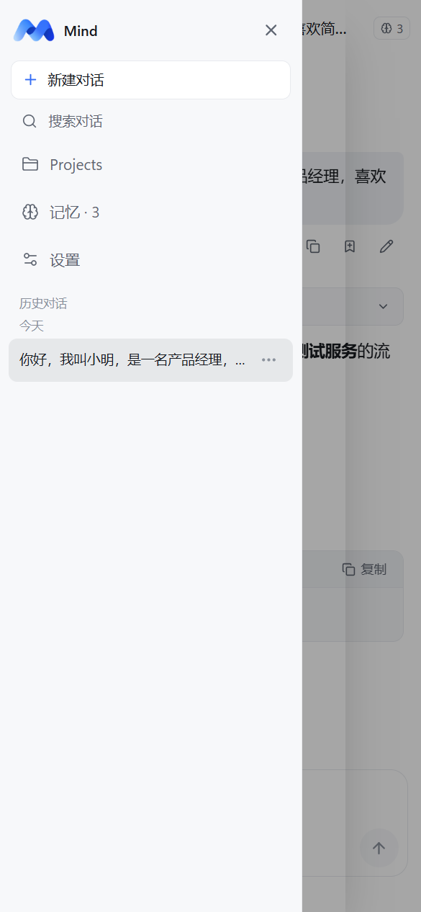
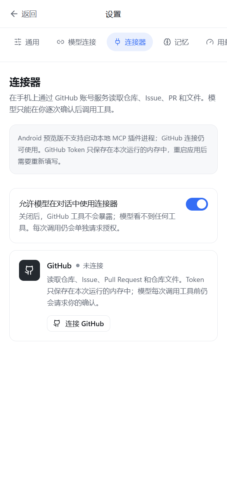
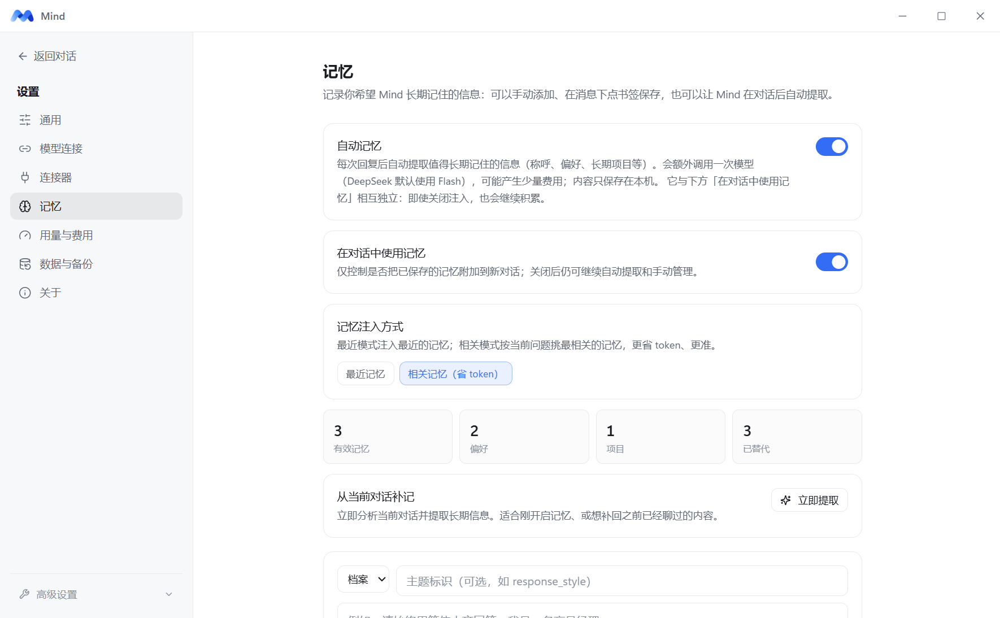
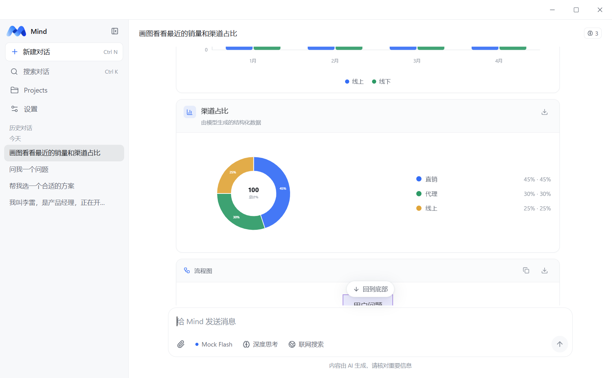

<p align="center">
  
</p>

<h1 align="center">Mind</h1>

<p align="center">
  本地优先的 Windows / Android AI 客户端 · 自带 Key · 上下文与费用可控
</p>

<p align="center">
  
  
  
  
  
</p>

<p align="center">
  <a href="https://github.com/stone2010/Mind/releases/tag/v0.1.1"><strong>下载 Windows 安装包</strong></a>
  ·
  <a href="https://github.com/stone2010/Mind/releases/tag/v0.1.1-android-preview">下载 Android 预览 APK</a>
</p>

Mind 是一个面向普通用户的本地优先 AI 客户端：安装后填入 DeepSeek API Key 就能聊天，聊天记录、记忆、用量都保存在本机。默认 100k 上下文并在超出预算时自动压缩；支持联网搜索、长期记忆、本地 MCP 插件、GitHub 只读连接，以及 Mermaid 流程图和数据图表。

> 当前版本为 `0.1.1`，提供 Windows 安装包与 Android 预览 APK。项目没有使用 Mind 自己的服务器中转请求，API Key 不会上传。

## 界面

<p align="center">
  
  
</p>

<p align="center">
  
  
</p>

## 功能亮点

| 能力 | 说明 |
| --- | --- |
| 首次配置引导 | 连接模型 → 选择上下文与功能偏好 → 选择插件；API Key 有获取步骤和真实连接测试 |
| 类似网页版的聊天 | 流式输出、Markdown、表格、代码高亮与复制、KaTeX 公式、附件、图片、停止生成、重新生成、编辑重发 |
| 上下文与费用 | 4k / 8k / 16k / 100k / 完整历史，或自定义 0–128k；超出 85% 自动压缩较早对话 |
| 联网搜索 | DeepSeek 服务端 `deepseek_web_search`，展示搜索查询与来源卡片，支持多轮工具历史 |
| 长期记忆 | 默认开启自动提取；可在消息下书签保存、从当前对话补记、手动管理；支持最近/相关记忆注入与去重 |
| 用量与费用 | 记录真实 token（含缓存命中/未命中），DeepSeek 按官方峰谷价自动估算，其他模型可单独配价；对话标题栏实时显示「约 X 分」；可关闭 |
| 数据备份 | 导出/导入 JSON；包含对话、消息、项目、记忆和用量，不包含密钥和设置；可合并或覆盖；Android 使用复制/文件选择器 |
| 可视化 | 渲染 Mermaid 流程图、柱状/折线/饼图；Markdown 图片点击放大 |
| 本地 MCP 插件 | 插件中心、Node/uv 环境检测、一键添加、工具列表、失败 stderr 提示（仅 Windows） |
| GitHub | 使用 Personal Access Token 读取仓库、Issue、PR、搜索和文件；Windows 存入凭据管理器，Android 预览版仅保存在本次运行内存 |
| 移动界面 | Android 抽屉侧栏、移动设置页、软键盘避让与系统栏安全区域；本地 MCP 在 Android 上关闭 |
| 本地优先 | 对话、项目、记忆、设置、用量存在本地 SQLite；API Key / GitHub Token 存在 Windows Credential Manager 或 Android 会话内存 |
| 法律与隐私 | 首次使用前的用户协议/隐私确认；协议与隐私说明随仓库公开 |

## 快速开始

### 直接使用

从 [Releases](https://github.com/stone2010/Mind/releases/tag/v0.1.1) 下载 `Mind_0.1.1_x64-setup.exe`，运行安装向导即可。安装包未签名，Windows SmartScreen 可能提示未知发布者；请确认下载来源。

也可以从源码构建，安装包位于：

```text
src-tauri/target/release/bundle/nsis/Mind_0.1.1_x64-setup.exe
```

首次打开：

1. 阅读并同意用户协议与隐私说明；
2. 选择「开始配置」；
3. 填入 DeepSeek API Key（可在 DeepSeek 开放平台创建）；
4. 选择上下文长度与功能偏好；
5. 可选安装本地插件，或直接在「设置 → 连接器」中配置 GitHub；
6. 开始聊天。

### Android 预览版

Android 版使用同一套 React UI 和 Rust 后端，通过 Tauri 2 打包为 APK。当前提供 `arm64-v8a` 调试构建，最低 Android 7.0，适合尝鲜与验证，不建议作为日常主力版本。

下载：[Android 预览 APK](https://github.com/stone2010/Mind/releases/tag/v0.1.1-android-preview)

<p align="center">
  
  
  
</p>

> 以上为 390×844 的移动布局预览（桌面 WebView 模拟 Android 视口与 UA），不是 Android 真机截图。
移动端已适配：

- 抽屉式历史侧栏与移动端设置导航
- 软键盘避让、系统栏安全区域、界面内的返回按钮
- 聊天、流式输出、Markdown / 公式 / Mermaid / 图表
- 联网搜索、长期记忆、用量与费用、GitHub 只读连接
- 数据备份：复制 JSON 导出，文件选择器导入

Android 预览版限制：

- API Key 与 GitHub Token 只保存在本次运行的内存中，重启后需重新输入；尚未接入 Android Keystore
- 不支持本地 MCP 插件（不启动 Node/uvx 子进程），GitHub 连接保留
- 使用 debug 签名，不适合上架或正式分发
- 当前构建环境没有连接真机或模拟器，APK 已通过编译与静态检查，但尚未在手机上完成运行时验证
- 备份不能直接写入系统下载目录；需复制 JSON 内容并自行保存

### 从源码运行（Windows）

前置条件：

- Windows 10 / 11
- WebView2 Runtime
- Node.js 20+
- Rust stable（MSVC 工具链）
- Visual Studio Build Tools（C++）

```bash
git clone https://github.com/stone2010/Mind.git
cd Mind
npm install
npm run tauri dev
```

仅构建前端：

```bash
npm run build
```

构建 Windows 安装包：

```bash
npm run tauri build
```

构建 Android 预览 APK（需要 JDK 17、Android SDK 36、Build Tools 36、NDK 27 与 Rust Android targets）：

```bash
npx tauri android build --apk --debug --target aarch64
```

首次构建前如果还没有 `src-tauri/gen/android`，先运行 `npx tauri android init --ci`。Windows 未开启“开发者模式”时，Tauri CLI 无法为原生库创建符号链接；需要在系统设置中开启开发者模式，或直接使用 Gradle 打包 `assembleArm64Debug` 并跳过 Rust 构建任务（详见 [Android 预览版说明](docs/release-notes-v0.1.1-android-preview.md)）。

## 上下文与省 token

设置 → 通用 → 对话上下文：

- 预设：精简 4k / 平衡 8k / 较长 16k / 长上下文 100k（默认）/ 完整历史
- 自定义上限：0–128k tokens，输入 0 表示不限制
- 自动压缩：历史超过预算 85% 时，用一次轻量模型调用把较早消息合并为摘要并持久化；之后只发送摘要 + 最近消息
- 普通对话默认注入一段轻量身份与风格提示词；开启「主动澄清 / 主动可视化 / 联网搜索 / 连接器」后追加对应协议；开启长期记忆时再注入记忆（这些提示词计入上下文预算）
- 记忆最多注入 24 条（相关模式最多 8 条）、每条最多 200 字，并限制在上下文预算约四分之一
- 只有带工具的 assistant 历史才回传 `reasoning_content`，避免为旧回答重复支付思考 token

> 上下文 token 按字符保守估算，实际计费以模型服务商为准。自动压缩摘要可能丢失部分细节，重要内容建议保存在项目或记忆中。

## 长期记忆

设置 → 记忆：

- 自动记忆默认开启：每次回复后由轻量模型（DeepSeek 用 Flash）提取稳定的称呼、身份、偏好和长期项目；从旧版升级会迁移一次，明确关闭过“使用记忆”的用户保持关闭
- 手动保存：任意消息下方点书签按钮；或在记忆页手动添加
- 从当前对话补记：打开一段已有对话，点「立即提取」，可补回开启记忆前的内容
- 注入与提取相互独立：「在对话中使用记忆」只控制是否把记忆发给模型；关闭后仍会继续积累
- 记忆分为档案 / 偏好 / 项目 / 事件 / 知识五类，每条包含主题、置信度、重要度、状态、有效期与来源
- 注入方式：最近记忆（默认）或相关记忆；相关模式使用 SQLite FTS5 关键词检索 + 重要度/置信度/时效/类型加权排序，最多注入 8 条；没有 FTS5 时自动降级为 LIKE 检索
- 同一主题的新事实会替代旧事实，旧版本保留在历史中；设置页可手动「整理记忆」并查看「为什么记得」、来源对话和历史版本
- 自动提取会做近似去重，并过滤 API Key、密码、银行卡、身份证等敏感内容
- 每次对话最多注入 24 条（相关模式最多 8 条）、每条最多 200 字，并受上下文预算约四分之一限制
- 对话标题栏显示有效记忆条数，点击可直接管理
- 提取失败会在界面提示原因，不再静默失败
- 删除记忆会同步清理 FTS 索引、来源记录与历史版本
- 所有记忆保存在本地 SQLite；自动提取会产生少量模型费用

> 当前版本使用 FTS5 + 关键词/元数据加权检索，尚未接入向量 Embedding；因此属于可用的 v1 混合检索，不是完整语义向量检索。FTS5 不可用时会自动降级，不影响聊天。

<p align="center">
  
</p>

## 可视化

- 柱状图 / 折线图：坐标轴、网格、数值标签、折线面积与多系列图例
- 饼图升级为环形图，显示百分比、总计与图例明细
- Mermaid 流程图自动适配宽度，并支持复制代码、下载 SVG
- 图表支持导出 SVG，便于放进文档或演示

<p align="center">
  
</p>

## 费用估算

- 对话标题栏实时显示「本对话 ≈ X 分」，按对话内的真实 usage 与模型价格计算。
- DeepSeek 使用官方 USD 价格 × 汇率估人民币：Flash 输入（缓存未命中）$0.15–0.30 / 输出 $0.60–1.20；Pro 输入 $0.66–1.32 / 输出 $1.98–3.96（每百万 tokens，谷时–峰时）。
- 缓存命中单独计价；usage 中的 `prompt_cache_hit_tokens` / `prompt_cache_miss_tokens` 会进入本地账单。
- 峰时为工作日北京时间 09:00–12:00、14:00–18:00，其余为谷时；法定节假日暂按工作日计算。
- 设置 → 用量与费用 可修改 USD→CNY 汇率，并为非 DeepSeek 模型填写峰谷输入/输出单价；未填写时只统计 token。
- 可关闭用量记录与对话内费用；关闭后不再写入新记录。
- 官方价格参考：[DeepSeek API Pricing](https://api-docs.deepseek.com/quick_start/pricing)

费用始终为估算值，缓存命中、赠送额度、阶梯价格和实际账单以服务商为准。

## 连接器与 GitHub

### 本地 MCP 插件

设置 → 连接器 → 推荐插件：

- 网页抓取（uvx）
- 时间与日期（uvx）
- 结构化记忆（npx）
- 文件与文件夹（npx，自行指定目录）

Mind 会检测 Node.js / uv，一键添加后真实启动 MCP 进程、完成 `initialize` 并读取 `tools/list`。也可以在手动表单中填写任意 stdio MCP 服务的启动命令和参数。

模型每次调用工具前都会弹出授权框，显示连接器、工具名与完整 JSON 参数；调用状态、参数和结果会随消息保存到 SQLite。

### GitHub 只读连接

在 GitHub 创建 Personal Access Token（建议 Fine-grained）：

1. 打开 GitHub 的 Personal Access Token 页面；
2. 授予 `Contents`、`Issues`、`Pull requests`、`Metadata` 的只读权限（私有仓库需额外选择仓库访问范围）；
3. 在 Mind 的「设置 → 连接器 → GitHub」粘贴 Token 并验证。

可用工具：

- 读取仓库基本信息
- 列出可访问仓库
- 搜索 GitHub 仓库
- 列出 Issue（自动过滤 Pull Request）
- 列出 Pull Request
- 读取文件内容或列出目录

GitHub 当前为只读连接，不支持创建/修改 Issue、提交代码或管理 Actions。Token 只保存在 Windows Credential Manager（条目 `github:main`），不会写入 SQLite、设置文件或日志。

> QQ 邮箱等邮件服务需要 IMAP/SMTP 授权码，当前版本尚未内置。

## 用量与费用

设置 → 用量与费用：

- 记录服务商返回的真实 `prompt_tokens` / `completion_tokens` / `total_tokens`
- 区分聊天、上下文压缩、自动记忆和 GitHub 工具轮次的模型消耗
- 峰谷时段可配置，默认谷时 00:30–08:30（本地时间）
- 按「元 / 百万 tokens」填写峰时、谷时输入/输出单价后估算费用
- 最近 14 天峰谷堆叠柱状图，可刷新、关闭记录或清除历史

没有填写单价时只显示真实 token，不生成虚构费用。缓存命中、赠送额度、阶梯价格等以服务商账单为准。

## 数据与隐私

- 数据库：Windows 为 `%APPDATA%\com.mind.desktop\mind.db`；Android 位于应用私有数据目录
- API Key：Windows Credential Manager（`provider:<id>`）；Android 预览版仅保存在本次运行的内存
- GitHub Token：Windows Credential Manager（`github:main`）；Android 预览版仅保存在本次运行的内存
- 模型请求直接发往你选择的模型服务商，不经过 Mind 中转
- MCP 插件以当前 Windows 用户权限在本机运行；每次工具调用都需要你批准；Android 预览版不启动本地 MCP
- GitHub 数据会发送给 GitHub 与所选模型服务；工具结果会进入模型上下文

### 导出与备份

设置 → 数据与备份：

- 导出 JSON：包含对话、消息、项目、记忆和用量；不包含 API Key、GitHub Token、连接器凭据和设置
- 导入：默认按 ID 合并；也可以开启“覆盖现有数据”清空后恢复
- Android 预览版：导出时复制 JSON 内容并保存为文件；导入时从系统文件选择器读取
- 备份文件可能包含隐私内容，请存放在可信位置
- 局域网自动同步尚未实现；可把备份放入同步盘（OneDrive、坚果云等）手动迁移

## 架构

```text
React / TypeScript UI
        │
        ▼
bridge.ts  ── Tauri IPC ──▶  Rust commands
                                  │
        ┌─────────────────────────┼─────────────────────────┐
        ▼                         ▼                         ▼
  SQLite（本地数据）     Windows Credential Manager     Provider API / MCP / GitHub
```

```text
src/
  components/     聊天、设置、连接器、用量、数据备份、法律门禁、可视化等 UI
  store/          Zustand 状态（app / chat / approvals / toast / confirm）
  lib/            Tauri IPC bridge、附件、工具函数、插件预设、计费
src-tauri/src/
  chat.rs         SSE 流式请求、工具调用循环、上下文裁剪
  compression.rs  滚动摘要 / 自动压缩
  connectors.rs   本地 MCP 客户端、工具路由、授权与进程管理
  github.rs       GitHub REST 只读工具与账号验证
  data.rs         JSON 数据导出与导入
  commands.rs     会话、消息、项目、记忆、设置、用量命令
  memory.rs       自动记忆提取与用量记录
  providers.rs    Provider 配置、HTTP 客户端与错误映射
  db.rs           SQLite 迁移与设置存储
scripts/dev/      CDP 驱动、OpenAI / MCP / GitHub Mock 服务
```

技术栈：Tauri 2、Rust、React 19、TypeScript、Vite 6、Tailwind CSS 3、Zustand、SQLite、Windows Credential Manager、Mermaid。Android 使用 Tauri 2 移动端、Gradle 与 Android SDK 36 / NDK 27。

## 验证状态

已通过：

- `npm run build`：TypeScript 与 Vite 构建通过
- `cargo test --lib`：16 个单元测试通过（凭据往返、上下文预算、摘要注入、记忆上限、结构化提取/去重/敏感过滤、数据库迁移与 FTS、reasoning 回传）
- 长期记忆端到端（本地 OpenAI 兼容 Mock）：旧设置迁移开启自动记忆 → 结构化提取类型/主题/置信度/重要度与来源消息 → 新对话通过 FTS + 元数据召回 → 同主题新事实替代旧事实并保留版本 → 整理记忆与历史查询 → 删除后 FTS 不再命中 → 关闭注入后仍继续提取 → 手动书签与「立即提取」可用
- 澄清交互：选项点按直接发送；文本题显示独立输入框并提交
- 可视化增强：柱状/折线图坐标、数值标签、折线面积、环图、百分比、SVG 下载与图表代码复制
- 本地 OpenAI 兼容 Mock：流式、取消、工具轮次、用量
- 本地 MCP Mock：`initialize`、`tools/list`、授权允许/拒绝、停止、持久化
- 本地 GitHub REST Mock：Token 验证、Token 不落入 SQLite、仓库/Issue/PR/搜索/文件工具、PR 过滤
- 上下文压缩：20 条长历史 + 新问题、4k 预算，摘要覆盖 18 条，后续请求只发送摘要 + 4 条消息
- 用量与费用：真实 usage（含缓存命中/未命中）累计、DeepSeek 官方峰谷价与汇率换算、每对话费用实时显示、非 DS 模型价格配置
- 数据备份：导出 JSON、校验不包含密钥、合并导入、覆盖导入；Android 模式的 JSON 导出与文件导入入口
- 法律确认：用户协议/隐私说明确认门禁、关于页入口
- 可视化：Mermaid、双系列柱状图、图片放大
- 首次配置：完整引导流程、100k 默认上下文、插件环境检测
- 移动布局：390×844 视口 + Android UA 下验证抽屉侧栏、移动设置导航、Android 连接器限制、数据备份入口，页面无横向溢出
- Android APK：编译成功，包名 `com.mind.desktop`、版本 0.1.1、minSdk 24、targetSdk 36，包含 arm64 原生库并通过调试签名校验

未验证 / 已知限制：

- 未使用真实 DeepSeek Key 发起收费调用；真实生成、搜索和自动记忆费用未在当前环境核对
- 未使用真实 GitHub Token 连接 GitHub.com；仅通过 GitHub REST Mock 验证请求路径与工具逻辑
- 第三方 MCP 插件包未在测试中实际下载和运行
- 自动压缩摘要为模型二次生成，可能遗漏细节
- 目前仅支持本地 stdio MCP；不支持远程 HTTP/SSE MCP、OAuth 和 MCP resources/prompts
- 未实现深度研究、语音、图像生成、Canvas、GPTs、定时任务、云同步、多设备与分享
- **Android 预览版未在真机或模拟器上运行验证**：当前构建环境没有连接设备；已通过编译、前端类型检查和 APK 静态检查，但启动、软键盘、文件选择器与真实 API 请求仍需在手机上确认
- Android 预览版尚未接入 Android Keystore，API Key 与 GitHub Token 只在本次运行内存中；不支持本地 MCP 插件，使用 debug 签名
- 局域网自动同步尚未实现；目前提供 JSON 导出/导入，可放入 OneDrive、坚果云等同步盘手动迁移
- 未做多实例互斥、自动更新与代码签名

## 用户协议与隐私

- [用户协议](docs/USER_AGREEMENT.md)
- [隐私说明](docs/PRIVACY.md)

应用首次使用前会显示确认门禁；同意记录保存在本地设置中。仓库公开后，协议与隐私说明也可以直接在 GitHub 查看。

> 这两份文本是项目初始模板，不构成法律意见。正式公开分发或商业化前，请让执业律师根据你的运营主体、所在地、收费方式和第三方服务条款进行审核；特别是责任限制、赔偿、管辖和消费者权益条款。没有任何协议能完全消除法律风险。

## Roadmap

- Android 正式版：Android Keystore、发布签名、真机回归与上架准备
- QQ 邮箱 / IMAP 连接器与安全授权码管理
- 远程 MCP、OAuth 与更多 SaaS 连接器
- GitHub 写操作（创建 Issue、评论、分支与 PR）
- 局域网自动同步与冲突合并
- 更细的上下文可视化与真实费用校准
- 安装包签名、自动更新与崩溃报告

## 说明

Mind 仓库已公开，但目前没有选择开源许可证；未经权利人许可，请勿再分发或商用。如需采用 MIT / Apache-2.0 等许可证，请先补充 LICENSE 文件。
